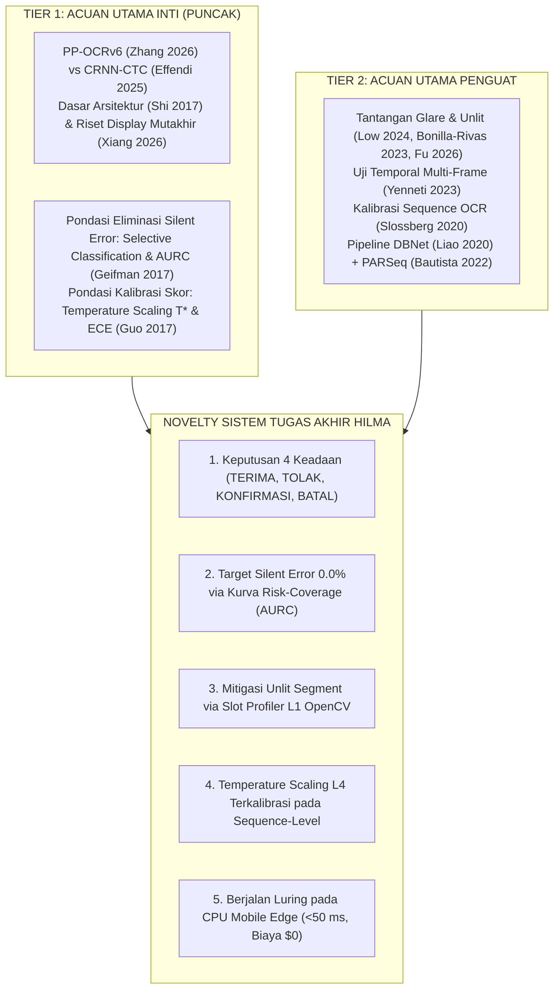

# Evaluasi Akreditasi Literatur, Analisis Sitasi, dan Pemetaan Novelty Riset

**Peneliti**: Hilma Amalia Putri (NPM: `237006010`)  
**Pembimbing**: 1. Dr. Ir. Aradea, S.T., M.T., CIRR. | 2. Neng Ika Kurniati., S.Si., M.Cs.  
**Judul Tugas Akhir**: *Komparasi dan Verifikasi Model Pengenalan Karakter Optis pada Tampilan Tujuh Segmen Timbangan Industri*  
**Berkas Spreadsheet**: [Manajemen_Skripsi_Hilma_Amalia_Putri.xlsx](file:///c:/Tugas%20Akhir/rencana%20baru/Manajemen_Skripsi_Hilma_Amalia_Putri.xlsx) (Sheet: `Literatur`)  
**Tautan Google Drive Pustaka**: [Google Drive Folder Pustaka Hilma](https://drive.google.com/drive/folders/1j1fDDoQguCMx6-iaTYqIlzpg8T0I-ZBU?usp=sharing)

---

## 1. Komposisi Bersih Sumber Pustaka (Total 30 Pustaka)

Sesuai arahan, seluruh pustaka yang tidak relevan (*Charles dkk. 2021* dan *Valente dkk. 2025*) telah **dieliminasi total**. Komposisi pustaka ilmiah kini terbagi menjadi 3 kelompok yang sangat jelas dan terpisah:

1. **19 Jurnal Koleksi Awal** (Tersimpan di folder lokal [jurnal/](file:///c:/Tugas%20Akhir/rencana%20baru/jurnal/) dan Google Drive Anda).
2. **7 Jurnal Baru Hasil Penelusuran Sitasi**:
   * **4 Berkas Berhasil Diunduh** (Tersimpan di folder baru [literatur baru/](file:///c:/Tugas%20Akhir/rencana%20baru/literatur%20baru/)):
     1. `[2017] Geifman & El-Yaniv - Selective Classification for Deep Neural Networks.pdf`
     2. `[2017] Guo dkk - On Calibration of Modern Neural Networks.pdf`
     3. `[2020] Slossberg dkk - On Calibration of Scene-Text Recognition Models.pdf`
     4. `[2020] Liao dkk - Real-time Scene Text Detection with DBNet.pdf`
   * **3 Jurnal Baru Terkunci / Berbayar di IEEE Xplore** (Tautan resmi & DOI tercatat di spreadsheet; berkas PDF fisik belum diunduh):
     5. *Finnegan dkk. (2019)* — IEEE TIM (Scopus Q1, IF 5.6)
     6. *Wannachai dkk. (2020)* — IEEE ECTI-CON (Scopus Indexed)
     7. *Rosyady & Wijaya (2021)* — IEEE ICEEI (SINTA Recognized)
3. **4 Buku Teks Babon Standar Acuan** (Diakses melalui referensi perpustakaan/e-book resmi):
   * *Gonzalez & Woods (2018)*, *Szeliski (2022)*, *Goodfellow dkk. (2016)*, *Bishop (2006)*.

---

## 2. Katalog Lengkap 30 Pustaka dengan Predikat Hierarki & Kategori Sumber

| No | Kode | Kategori Sumber | Predikat Hierarki Acuan | Penulis & Tahun | Judul Makalah / Buku | Nama Jurnal / Penerbit | Indeks & Akreditasi | Tautan Akses Langsung Berkas / Web |
| :---: | :---: | :--- | :--- | :--- | :--- | :--- | :--- | :--- |
| **1** | `LIT-01` | Mandiri | **Tier 1 — Acuan Utama Inti (Puncak)** | Zhang dkk. (2026) | *PP-OCRv6: From 1.5M to 34.5M Parameters* | arXiv (PaddlePaddle Baidu) | ArXiv / Top AI Report | [Buka Berkas PDF](https://drive.google.com/file/d/1fNJCCjLOcocs4JnAcfwoTwYv4SwvGJJc/view) |
| **2** | `LIT-02` | Mandiri | **Tier 1 — Acuan Utama Inti (Puncak)** | Effendi dkk. (2025) | *Data Logger Real-Time CRNN-CTC 7-Segment* | JIIF, Vol. 9(2): 107-115 | **SINTA 3** (UNPAD) | [Buka Berkas PDF](https://drive.google.com/file/d/1dgcrSCs_0zrYdb2q0OqUqNMR4LyLqmHI/view) |
| **3** | `LIT-03` | Rujukan Sitasi Jurnal Zhang dkk. (2026) | **Tier 1 — Acuan Utama Inti (Puncak)** | Geifman & El-Yaniv (2017) | *Selective Classification for Deep Neural Networks* | NeurIPS 2017 | **CORE A\* / Scopus Q1** | [Buka Berkas PDF](https://drive.google.com/file/d/1NrJT3P405UHhlPjSoV7SVciEOh45MYn1/view) |
| **4** | `LIT-04` | Rujukan Sitasi Jurnal Zhang dkk. (2026) | **Tier 1 — Acuan Utama Inti (Puncak)** | Guo dkk. (2017) | *On Calibration of Modern Neural Networks* | ICML 2017 | **CORE A\* / Scopus Q1** | [Buka Berkas PDF](https://drive.google.com/file/d/14gkA7M8p1MjmyDWENE91cFbkO7S522Xc/view) |
| **5** | `LIT-05` | Mandiri | **Tier 1 — Acuan Utama Inti (Puncak)** | Shi dkk. (2017) | *An End-to-End Trainable Neural Network (CRNN)* | IEEE TPAMI, 39(11): 2298 | **Scopus Q1 / TPAMI** (IF 20.8) | [Buka Berkas PDF](https://drive.google.com/file/d/1YI5zfExgPXFw5hRH74-eeoyLgFt5gT6F/view) |
| **6** | `LIT-06` | Mandiri | **Tier 1 — Acuan Utama Inti (Puncak)** | Xiang dkk. (2026) | *Semi-Supervised Seven-Segment LED Display* | Sensors (MDPI), 26(1): 265 | **Scopus Q1 / SCIE** (IF 3.9) | [Buka Berkas PDF](https://drive.google.com/file/d/14ft9l5jpF7OTtJYgYA2lsGCT2FEyRfdk/view) |
| **7** | `LIT-07` | Mandiri | **Tier 2 — Acuan Utama Penguat** | Cui dkk. (2026) | *PP-OCRv5: Specialized 5M-Parameter Model* | arXiv (PaddlePaddle Baidu) | ArXiv / Top AI Report | [Buka Berkas PDF](https://drive.google.com/file/d/1znJUbt3_3iMuMkpvriMILWVhrfvcgzUl/view) |
| **8** | `LIT-08` | Mandiri | **Tier 2 — Acuan Utama Penguat** | Low dkk. (2024) | *Detecting Seven Segment Digits (Glare Failure)* | ITM Web of Conf., 63: 01007 | **Scopus Indexed** | [Buka Berkas PDF](https://drive.google.com/file/d/19wS3MgF6bmHxsq95OZLpXx-JOjPM85nE/view) |
| **9** | `LIT-09` | Mandiri | **Tier 2 — Acuan Utama Penguat** | Bonilla-Rivas dkk. (2023) | *Adapting YOLO to Real Numbers in 7-Segment* | 2023 IEEE ICCNS | **IEEE / Scopus Indexed** | [Buka Berkas PDF](https://drive.google.com/file/d/1Q-6drhB1g120h9vKVnbJqH2GSdEEpqLi/view) |
| **10** | `LIT-10` | Mandiri | **Tier 2 — Acuan Utama Penguat** | Fu dkk. (2026) | *Illumination Correction Network Digital Meter* | J. Imaging (MDPI), 12(4): 146 | **Scopus Q2 / ESCI** | [Buka Berkas PDF](https://drive.google.com/file/d/1a8aZYY8QKrmubhFc-wD_JvVkxD2Rtexh/view) |
| **11** | `LIT-11` | Mandiri | **Tier 2 — Acuan Utama Penguat** | Yenneti dkk. (2023) | *Single Pass Reading Extraction 7-Segment* | Electronic Imaging, 35(7): 282 | **Scopus Indexed** (IS&T) | [Buka Berkas PDF](https://drive.google.com/file/d/1KQusvC7zNjieG63V6R8n8SnzaXtF-HZN/view) |
| **12** | `LIT-12` | Mandiri | **Tier 2 — Acuan Utama Penguat** | Kanagarathinam & Sekar (2019) | *Text Detection Seven Segment Energy Meter* | Energy Reports, 5: 842-852 | **Scopus Q1 / SCIE** (IF 5.2) | [Buka Berkas PDF](https://drive.google.com/file/d/1i80GjCgFUZlbQRgAbGJss4TGRhoBLm84/view) |
| **13** | `LIT-13` | Rujukan Sitasi Jurnal Cui dkk. (2026) | **Tier 2 — Acuan Utama Penguat** | Slossberg dkk. (2020) | *On Calibration of Scene-Text Recognition Models* | ACCV 2020 / arXiv:2012.12643 | **Scopus Q1 / ACCV** | [Buka Berkas PDF](https://drive.google.com/file/d/1FcudqxJZu9E9DOAD8pQgPZHIUQ1H6lT4/view) |
| **14** | `LIT-14` | Rujukan Sitasi Jurnal Low dkk. (2024) | **Tier 2 — Acuan Utama Penguat** | Finnegan dkk. (2019) | *Automated Method for 7-Segment Digits* | IEEE TIM, 68(9): 3204-3212 | **Scopus Q1 / IEEE TIM** (IF 5.6) | [Akses DOI IEEE](https://doi.org/10.1109/TIM.2018.2878004) *(Terkunci)* |
| **15** | `LIT-15` | Rujukan Sitasi Jurnal Fu dkk. (2026) | **Tier 2 — Acuan Utama Penguat** | Liao dkk. (2020) | *Real-time Text Detection with DBNet* | AAAI 2020, 34(07): 11474 | **CORE A\* / Scopus Q1** | [Buka Berkas PDF](https://drive.google.com/file/d/1zbTTT2vC1_oJJwNFsdRsVPNTrAbB7Ozt/view) |
| **16** | `LIT-16` | Mandiri | **Tier 2 — Acuan Utama Penguat** | Bautista & Atienza (2022) | *Scene Text Recognition with PARSeq* | ECCV 2022 (LNCS 13688) | **CORE A\* / Scopus Q1** | [Buka Berkas PDF](https://drive.google.com/file/d/1wpdvpuZxCwlF-QQ-Tu96kKjqWzV6pJi2/view) |
| **17** | `LIT-17` | Mandiri | **Tier 2 — Acuan Utama Penguat** | Wei dkk. (2023) | *Short-Memory Sequence Model Digital Instruments* | Algorithms (MDPI), 16(4): 192 | **Scopus Q2 / ESCI** | [Buka Berkas PDF](https://drive.google.com/file/d/1FFcOQjwK8WtJo69a4weynZ33Zj2Qlai_/view) |
| **18** | `LIT-18` | Mandiri | **Tier 3 — Acuan Pendukung** | Graves dkk. (2006) | *Connectionist Temporal Classification (CTC)* | ICML 2006 (ACM, pp. 369-376) | **CORE A\* / Scopus Q1** | [Buka Berkas PDF](https://drive.google.com/file/d/1vk6m-Q-k_CP0QVMBQh6aoDpARvgnFHsG/view) |
| **19** | `LIT-19` | Mandiri | **Tier 3 — Acuan Pendukung** | Gushima & Kashima (2023) | *Automatic Generation 7-Segment Display Image* | PHM Society Asia-Pacific 2023 | **Scopus Indexed** (Mitsubishi) | [Buka Berkas PDF](https://drive.google.com/file/d/1Fz2ZvivYQR2YZiS-AqCVI1RFZLehKX4T/view) |
| **20** | `LIT-20` | Mandiri | **Tier 3 — Acuan Pendukung** | Ega dkk. (2026) | *Leveraging VLMs on Digital Measuring Devices* | Bulletin of EEI, 15(5): 4239 | **Scopus Q3 / SINTA 1** (UI) | [Buka Berkas PDF](https://drive.google.com/file/d/13nt6Zf3eFV5FMXxPrKX3Q6uwf5MaU2pD/view) |
| **21** | `LIT-21` | Mandiri | **Tier 3 — Acuan Pendukung** | Sheng dkk. (2019) | *NRTR: No-Recurrence Model Scene Text* | ICDAR 2019 (IEEE, pp. 781-786) | **CORE A / Scopus Q1** | [Buka Berkas PDF](https://drive.google.com/file/d/12ap5x8tk90V5iB2LFfCDZqhzoQf3bo43/view) |
| **22** | `LIT-22` | Mandiri | **Tier 3 — Acuan Pendukung** | Laroca dkk. (2019) | *CNNs for Automatic Meter Reading (AMR)* | J. Electronic Imaging, 28(1) | **Scopus Q3 / SCIE** | [Buka Berkas PDF](https://drive.google.com/file/d/1z6AqHJFkhbngQrwMxmhJmOoKMjMUHsTZ/view) |
| **23** | `LIT-23` | Mandiri | **Tier 3 — Acuan Pendukung** | Lin dkk. (2026) | *MeasureBench: Benchmarking Measurement Reading* | arXiv:2602.04944 (BAAI FlagEval) | ArXiv / Top AI Benchmark | [Buka Berkas PDF](https://drive.google.com/file/d/1UztNa4qROc3x4Q-ZvkKh3MRwqPHWj4Vn/view) |
| **24** | `LIT-24` | Mandiri | **Tier 3 — Acuan Pendukung** | Kulkarni dkk. (2021) | *CNN-Based LCD Transcription Low-Resource* | Frontiers in AI, 4: 543176 | **Scopus Q2 / DOAJ** | [Buka Berkas PDF](https://drive.google.com/file/d/19KgGcGDPn-DTUjzPjSFuBRJ5Y4sIk2Qq/view) |
| **25** | `LIT-25` | Rujukan Sitasi Jurnal Xiang dkk. (2026) | **Tier 3 — Acuan Pendukung** | Wannachai dkk. (2020) | *Real-time 7-Segment Display Detection CNN* | 2020 IEEE ECTI-CON | **IEEE / Scopus Indexed** | [Akses DOI IEEE](https://doi.org/10.1109/ECTI-CON49241.2020.9158302) *(Terkunci)* |
| **26** | `LIT-26` | Rujukan Sitasi Jurnal Fu dkk. (2026) | **Tier 3 — Acuan Pendukung** | Rosyady & Wijaya (2021) | *AI-Powered Monitoring System for kWh Meters* | 2021 IEEE ICEEI | **IEEE / SINTA Recognized** | [Akses DOI IEEE](https://doi.org/10.1109/ICEEI52627.2021.9611884) *(Terkunci)* |
| **27** | `LIT-27` | Buku | **Tier Buku Babon (Standar Teori)** | Gonzalez & Woods (2018) | *Digital Image Processing (4th Ed.)* | Pearson Education | Standar Internasional | [Akses Web Pearson](https://www.pearson.com/en-us/subject-catalog/p/digital-image-processing/P200000003264) |
| **28** | `LIT-28` | Buku | **Tier Buku Babon (Standar Teori)** | Szeliski (2022) | *Computer Vision: Algorithms and Applications (2nd)* | Springer Nature | Standar Internasional | [Akses Web Szeliski](https://szeliski.org/Book/) |
| **29** | `LIT-29` | Buku | **Tier Buku Babon (Standar Teori)** | Goodfellow dkk. (2016) | *Deep Learning* | MIT Press | Standar Internasional | [Akses Deep Learning Book](https://www.deeplearningbook.org/) |
| **30** | `LIT-30` | Buku | **Tier Buku Babon (Standar Teori)** | Bishop (2006) | *Pattern Recognition and Machine Learning* | Springer | Standar Internasional | [Akses Web Springer](https://www.springer.com/gp/book/9780387310732) |

---

## 3. Pembedahan Novelty Berdasarkan Hierarki Pustaka

