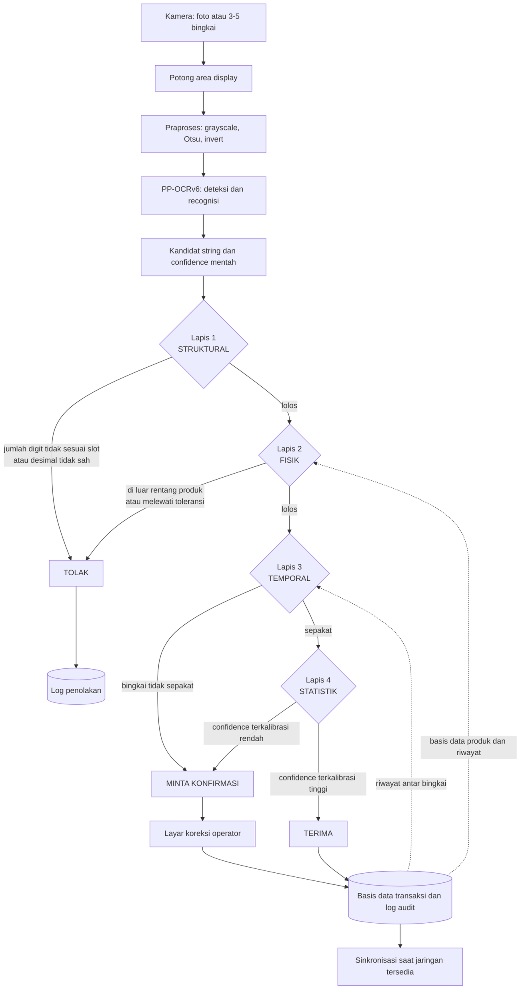

# Draft Laporan 01 — Kerangka Proposal

> Status: DRAF untuk dilaporkan ke pembimbing.
> Basis keputusan: kandidat **K1**, bentuk TA **pembangunan sistem** (bentuk 1, pasal 1.1.2).
> Kebijakan data: latih sintetis, uji memuat foto nyata.
> Acuan format: **Pedoman Pelaksanaan TA `FT.IF-AKD-F.A.05`** — rincian kepatuhan di `docs/04-kepatuhan-pedoman.md`.

**Catatan konversi ke naskah.** Dokumen ini ditulis mengikuti gaya pedoman: tanpa kata ganti orang, tanpa bullets, sitasi berbentuk (Nama, Tahun). Penanda `[S##]` disisipkan setelah sitasi hanya sebagai nomor lacak internal repo ini. Sebelum dipindahkan ke Word, hapus semua penanda berpola ` [S##]` — pedoman hanya mengizinkan bentuk (Nama, Tahun).

---

## 1. Judul

**Rekomendasi utama:**

> **Verifikasi Kontekstual Hasil Pembacaan Display Tujuh Segmen untuk Sistem Pencatatan Timbangan Digital**

Nama model (PP-OCRv6) tidak dimasukkan ke judul. Pertimbangannya: model sejenis berganti generasi dalam hitungan bulan, sedangkan judul harus bertahan sampai sidang dan sesudahnya. Nama model tetap dicantumkan pada Bab I dan Bab III, bukan pada judul.

**Opsi alternatif:**

| # | Judul | Catatan |
|---|---|---|
| a | Sistem Pencatatan Timbangan dengan Verifikasi Berlapis Pembacaan Display Tujuh Segmen | Menonjolkan kata "sistem", sesuai bentuk pembangunan sistem |
| b | Verifikasi Berlapis untuk Menekan Kesalahan Senyap pada Pembacaan Display Tujuh Segmen | Paling menonjolkan kontribusi, tetapi istilah "kesalahan senyap" perlu didefinisikan lebih awal |

---

## 2. Ringkasan / Gambaran Umum

Pencatatan berat barang di gudang dan pabrik masih banyak dilakukan secara manual: operator membaca angka pada display timbangan digital, kemudian menuliskannya. Cara tersebut tidak memiliki pembanding otomatis dan tidak meninggalkan jejak audit, sehingga kesalahan catat tidak terdeteksi dan sengketa jumlah barang sulit ditelusuri. Kebutuhan akan perekaman otomatis telah dijawab di literatur, antara lain oleh sistem pencatat data berbasis CRNN-CTC untuk display tujuh segmen (Effendi, dkk., 2025) [S01].

Penelitian ini tidak mengulang persoalan pembacaan, melainkan mengambil titik yang belum dijawab. Effendi, dkk. melaporkan akurasi pengenalan, tetapi tidak melaporkan bagaimana sistem bersikap ketika bacaannya salah (Effendi, dkk., 2025) [S01]. Pada 24 sumber yang ditelusuri, tidak ditemukan pelaporan *silent error rate*, kurva risk–coverage, maupun *selective accuracy* untuk display tujuh segmen. Padahal dalam pencatatan timbangan, satu bacaan salah lebih mahal daripada sepuluh bacaan yang ditolak, karena bacaan salah masuk ke catatan dan baru diketahui setelah transaksi selesai.

Pendekatan yang diusulkan adalah menambahkan empat lapis verifikasi kontekstual di atas keluaran model OCR. Lapis pertama bersifat **struktural**, yaitu memeriksa jumlah digit terhadap jumlah slot dan posisi desimal yang sah. Lapis kedua bersifat **fisik**, yaitu memeriksa rentang berat produk, toleransi, dan selisih terhadap riwayat. Lapis ketiga bersifat **temporal**, yaitu memeriksa kesepakatan antar bingkai pada pembacaan yang sama. Lapis keempat bersifat **statistik**, yaitu memakai keyakinan model yang telah dikalibrasi. Keluaran sistem bukan sekadar teks angka, melainkan keputusan **terima, tolak, atau minta konfirmasi**, beserta alasannya.

Model dasar yang dipakai adalah PP-OCRv6, keluarga model OCR ringan berukuran 1,5 hingga 34,5 juta parameter yang dirilis Juni 2026 (Zhang, dkk., 2026) [S14]. Model tersebut dipilih atas tiga pertimbangan. Pertama, ukurannya memungkinkan berjalan offline pada perangkat terbatas. Kedua, arsitekturnya dirancang khusus untuk OCR dan mengklaim mengungguli model bahasa-visi berukuran miliaran parameter pada tugas serupa (Zhang, dkk., 2026) [S14]. Ketiga, model tersebut secara eksplisit menyebut display digital sebagai sasaran khusus (Zhang, dkk., 2026) [S14]. Persoalan yang belum terjawab: model tersebut belum pernah diuji pada display tujuh segmen.

Data latih dihasilkan secara sintetis dengan kondisi terkontrol, sedangkan data uji memuat citra timbangan nyata yang dikunci. Keberhasilan diukur dengan *silent error rate*, *coverage*, *selective accuracy*, dan luas daerah di bawah kurva risk–coverage, bukan dengan akurasi semata.

---

## 3. State of the Art

### 3.1 Peta pendekatan

Literatur pembacaan display tujuh segmen dapat dipetakan menjadi lima kelompok sebagai berikut.

| # | Kelompok | Sumber | Hasil yang dilaporkan | Keterbatasan untuk penelitian ini |
|---|---|---|---|---|
| a | Klasik non-pembelajaran mesin | ssocr (Auerswal, t.t.) [S18]; binarisasi adaptif, proyeksi, dan Hamming (Jiang dan Li, 2026) [S09] | 99,7% pada 1.146 karakter dalam 20 ms, diuji pada timbangan elektronik (Jiang dan Li, 2026) [S09] | Bergantung pada kondisi citra; perilaku saat gagal tidak dilaporkan |
| b | Deep learning khusus tujuh segmen | CRNN-CTC (Effendi, dkk., 2025) [S01]; generator sintetis dan model desimal terpisah (Gushima dan Kashima, 2023) [S07]; kepala inferensi digit (Yenneti, dkk., 2023) [S08]; YOLO untuk angka riil (Bonilla-Rivas, dkk., 2023) [S16]; YOLOv8 + CRNN (OICWS, 2026) [S17]; DBNet + PARSeq (Low, dkk., 2024) [S04]; model short-memory (Wei, dkk., 2023) [S11]; semi-supervised (Xiang, dkk., 2026) [S06]; koreksi iluminasi (Fu, dkk., 2026) [S10] | 90,37% *exact match* dengan CER 3,6% (Effendi, dkk., 2025) [S01]; 96,8% (Gushima dan Kashima, 2023) [S07]; 97,8% per bingkai pada 30 fps (Yenneti, dkk., 2023) [S08]; 98% (OICWS, 2026) [S17] | Seluruhnya berhenti pada akurasi dataset sendiri; keandalan tidak dilaporkan |
| c | Dataset dan tolok ukur | UFPR-AMR (Laroca, dkk., 2019) [S03]; citra mentah meter energi (Kanagarathinam dan Sekar, 2019) [S12] | 2.000 citra dan 10.000 anotasi digit (Laroca, dkk., 2019) [S03] | Mayoritas meter energi listrik, bukan timbangan |
| d | OCR umum generasi baru | PP-OCRv6 (Zhang, dkk., 2026) [S14]; PP-OCRv5 (Zhang, dkk., 2026b) [S22] | 83,2% akurasi pengenalan rata-rata 15 kategori pada 34,5 juta parameter (Zhang, dkk., 2026) [S14]; 5 juta parameter menyaingi model bahasa-visi miliaran parameter (Zhang, dkk., 2026b) [S22] | Mengklaim menangani digital display, belum diuji pada tujuh segmen |
| e | Model bahasa-visi | Gemini dan lima mesin OCR (Ega, dkk., 2026) [S02]; MeasureBench (Lin, dkk., 2026) [S13] | FSR 93,85% dan akurasi per digit 98,10% (Ega, dkk., 2026) [S02]; terbaik hanya 30,2% pada data nyata (Lin, dkk., 2026) [S13] | Akurat pada transkripsi, lemah pada inferensi skala; membutuhkan jaringan dan biaya |

Dasar metode yang dipakai kelompok b dan d adalah CRNN (Shi, dkk., 2017) [S19], CTC (Graves, dkk., 2006) [S20], NRTR (Sheng, dkk., 2019) [S21], dan PARSeq (Bautista dan Atienza, 2022) [S24]. Konteks penerapan bergerak dari meter energi (Laroca, dkk., 2019) [S03] ke kamera ponsel untuk LCD medis (Kulkarni, dkk., 2021) [S05] dan pembacaan layar digital dengan *one-shot learning* (Charles, dkk., 2021) [S23].

### 3.2 Dua angka yang tampak bertentangan

Ega, dkk. melaporkan FSR sebesar 93,85% untuk Gemini pada perangkat ukur digital (Ega, dkk., 2026) [S02], sementara Lin, dkk. melaporkan model bahasa-visi terbaik hanya mencapai 30,2% pada data nyata (Lin, dkk., 2026) [S13]. Kedua angka tersebut tidak bertentangan. Lin, dkk. menguji pembacaan nilai yang menuntut penalaran spasial dan inferensi skala, sedangkan Ega, dkk. menguji transkripsi digit yang sudah tertulis.

Implikasi penulisan: kalimat "model bahasa-visi belum mampu membaca alat ukur" tidak dapat dipakai. Kalimat yang benar: model bahasa-visi lemah pada inferensi skala tetapi kuat pada transkripsi digit; karena itu pada domain ini model tersebut bukan pesaing akurasi, melainkan pesaing biaya.

### 3.3 Celah yang tersisa

| Celah | Isi | Status |
|---|---|---|
| G1 | Keandalan tidak pernah dilaporkan: tidak ada *silent error rate*, kurva risk–coverage, kalibrasi keyakinan, maupun *selective accuracy* untuk tujuh segmen | Terbuka |
| G3 | Verifikasi kontekstual tidak ada: tidak ada penelitian yang memakai konteks luar gambar untuk memutuskan kelayakan bacaan | Terbuka |
| G6 | PP-OCRv6 belum diuji pada tujuh segmen (Zhang, dkk., 2026) [S14] | Terbuka |
| G2 | Tidak ada tolok ukur lintas dataset | Terbuka |
| G4 | Error digit berulang dan titik desimal hanya merupakan catatan anekdotal (OICWS, 2026; Gushima dan Kashima, 2023) [S17, S07] | Terbuka sebagian |

### 3.4 Angka yang beredar tidak dapat dibandingkan

Angka 90,37% (Effendi, dkk., 2025) [S01], 96,8% (Gushima dan Kashima, 2023) [S07], 97,8% (Yenneti, dkk., 2023) [S08], 99,7% (Jiang dan Li, 2026) [S09], 98% (OICWS, 2026) [S17], dan 93,85% (Ega, dkk., 2026) [S02] dihasilkan dari data, pembagian latih-uji, dan definisi "benar" yang berbeda-beda. Tidak ditemukan studi yang melatih pada satu dataset lalu mengujinya pada dataset lain.

---

## 4. Tema Utama

### 4.1 Tema

> **Keandalan, bukan akurasi: membuat sistem pembacaan timbangan mengetahui kapan dirinya tidak layak dipercaya.**

### 4.2 Tiga sub-tema

**Sub-tema 1 — Kesalahan senyap sebagai persoalan utama.** Metrik yang lazim dipakai dalam literatur adalah CER dan *exact match* (Effendi, dkk., 2025; Gushima dan Kashima, 2023; Yenneti, dkk., 2023) [S01, S07, S08]. Keduanya mengukur seberapa sering model benar, bukan apakah sistem memberi tahu ketika salah. Pada domain penimbangan, bacaan salah yang diterima tanpa peringatan merupakan kegagalan yang paling mahal, karena masuk ke catatan dan baru terdeteksi setelah transaksi selesai. Karena itu metrik utama penelitian ini adalah *silent error rate*, bukan akurasi.

**Sub-tema 2 — Konteks di luar gambar sebagai sumber informasi baru.** Seluruh pendekatan pada kelompok a dan b mengambil keputusan dari citra saja. Penelitian ini menambahkan informasi yang tidak terdapat di dalam citra, yaitu jumlah slot digit pada display, rentang berat sah untuk suatu produk, toleransi penimbangan, kesepakatan antar bingkai, dan keyakinan yang telah dikalibrasi. Konsekuensinya, kontribusi tidak dapat direduksi menjadi model yang lebih baik: bila model dasarnya diganti, lapisan verifikasi tetap berlaku.

**Sub-tema 3 — *Selective prediction* sebagai kerangka evaluasi.** Keputusan menerima atau menolak bacaan merupakan persoalan *selective prediction*, yaitu sistem diberi kewenangan untuk menolak memprediksi. Kerangka tersebut telah mapan di bidang lain, tetapi belum dipakai pada domain display tujuh segmen. Besaran yang diukur bukan satu angka akurasi, melainkan hubungan antara *coverage*, yaitu persentase bacaan yang diterima otomatis, dan akurasi pada bacaan yang diterima, dinyatakan sebagai kurva risk–coverage dan diringkas sebagai AURC.

### 4.3 Posisi terhadap penelitian terdekat

| Dimensi | Effendi, dkk. (2025) [S01] | Penelitian ini |
|---|---|---|
| Pertanyaan | Apakah display tujuh segmen dapat dibaca dan dicatat otomatis? | Kapan bacaan tidak layak dipercaya, dan bagaimana sistem mengetahui? |
| Masukan | Citra | Citra dan konteks luar gambar |
| Keluaran | String angka | String, keputusan, dan alasan |
| Metrik utama | CER dan *exact match* | *Silent error*, *coverage*, *selective accuracy*, AURC |

---

## 5. Referensi

Daftar lengkap tersimpan di `references/references.bib`. Kolom "Sitasi dalam teks" sudah dalam bentuk yang dipakai di dalam naskah; penulisan daftar pustaka mengikuti pasal 2.3.2 pedoman.

| ID | Sitasi dalam teks | Tahun | Venue |
|---|---|---|---|
| S01 | Effendi, dkk. | 2025 | Jurnal Ilmu dan Inovasi Fisika 9(2) 107–115 |
| S02 | Ega, dkk. | 2026 | Bulletin of Electrical Engineering and Informatics 15(5) 4239–4252 |
| S03 | Laroca, dkk. | 2019 | Journal of Electronic Imaging 28(1) 013023 |
| S04 | Low, dkk. | 2024 | ITM Web of Conferences 63 01007 |
| S05 | Kulkarni, dkk. | 2021 | Frontiers in Artificial Intelligence 4 543176 |
| S06 | Xiang, dkk. | 2026 | Sensors 26(1) 265 |
| S07 | Gushima dan Kashima | 2023 | PHM Society Asia-Pacific Conference |
| S08 | Yenneti, dkk. | 2023 | Electronic Imaging 35(7) 282 |
| S09 | Jiang dan Li | 2026 | Proc. SPIE |
| S10 | Fu, dkk. | 2026 | Journal of Imaging 12(4) 146 |
| S11 | Wei, dkk. | 2023 | Algorithms 16(4) 192 |
| S12 | Kanagarathinam dan Sekar | 2019 | Energy Reports 5 842–852 |
| S13 | Lin, dkk. | 2026 | CVPR 2026 (arXiv:2510.26865) |
| S14 | Zhang, dkk. | 2026 | arXiv:2606.13108 |
| S15 | Valente, dkk. | 2025 | arXiv:2508.21732 |
| S16 | Bonilla-Rivas, dkk. | 2023 | ICCNS, 19–25 |
| S17 | OICWS | 2026 | GitHub: lcd-digit-recognition |
| S18 | Auerswal | t.t. | ssocr (perangkat lunak) |
| S19 | Shi, dkk. | 2017 | IEEE TPAMI 39(11) |
| S20 | Graves, dkk. | 2006 | ICML |
| S21 | Sheng, dkk. | 2019 | ICDAR |
| S22 | Zhang, dkk. | 2026b | arXiv:2603.24373 |
| S23 | Charles, dkk. | 2021 | WACV |
| S24 | Bautista dan Atienza | 2022 | ECCV (arXiv:2207.06966) |

DOI dan URL lengkap ada di `docs/research/source-ledger.md`. Perhatikan: S14 dan S22 sama-sama karya Zhang, dkk. pada 2026, sehingga di dalam teks dibedakan dengan akhiran 2026 dan 2026b sesuai pasal 2.3.1e pedoman.

---

## 6. Arsitektur (Bagan Alur)

### 6.1 Bagan alur utama



### 6.2 Bagan alur alternatif (teks)

```
foto atau video pendek
        |
        v
  potong area display -> praproses: grayscale, Otsu, invert
        |
        v
  PP-OCRv6 (deteksi dan recognisi) -> kandidat "48.65", confidence 0.91
        |
        +--> LAPIS 1 STRUKTURAL : jumlah digit terhadap slot, posisi desimal sah
        |            gagal -> TOLAK
        +--> LAPIS 2 FISIK      : rentang produk, toleransi, selisih riwayat
        |            gagal -> TOLAK
        +--> LAPIS 3 TEMPORAL   : kesepakatan antar bingkai
        |            gagal -> MINTA KONFIRMASI
        +--> LAPIS 4 STATISTIK  : confidence terkalibrasi
        |            rendah -> MINTA KONFIRMASI
        v
   TERIMA -> basis data transaksi dan log audit -> sinkronisasi
```

### 6.3 Penjelasan setiap blok

| Blok | Masukan | Keluaran | Alasan keberadaannya |
|---|---|---|---|
| Akuisisi | Foto atau 3–5 bingkai video | Citra dan metadata waktu | Lapis 3 memerlukan beberapa bingkai dari pembacaan yang sama |
| Pemotongan | Citra penuh | Area display | Mengurangi gangguan latar |
| Praproses | Area display | Citra siap model | Menyamakan kontras LED dan LCD pasif |
| PP-OCRv6 | Citra | String dan confidence mentah | Model dasar (Zhang, dkk., 2026) [S14]; confidence mentah belum bermakna tanpa kalibrasi |
| Lapis 1 struktural | String dan geometri slot | Lolos atau tolak | Menangkap pola kegagalan CTC pada digit berulang dan titik desimal (OICWS, 2026; Graves, dkk., 2006) [S17, S20] |
| Lapis 2 fisik | Angka dan konfigurasi produk | Lolos atau tolak | Menangkap bacaan yang mustahil secara domain |
| Lapis 3 temporal | Beberapa bingkai | Lolos atau konfirmasi | Bacaan benar cenderung stabil, kesalahan berubah-ubah; gagasan penyaringan antar bingkai telah dipakai (Yenneti, dkk., 2023) [S08], tetapi belum untuk keputusan terima atau tolak |
| Lapis 4 statistik | Confidence dan split kalibrasi | Lolos atau konfirmasi | Mengubah skor model menjadi perkiraan peluang benar |
| Keputusan | Hasil keempat lapis | Terima, tolak, atau konfirmasi | Inti kontribusi: sistem berubah dari pembaca menjadi penjaga gerbang |
| Penyimpanan | Keputusan dan alasan | Baris basis data dan log audit | Menjadi bahan perhitungan *silent error* dan tingkat koreksi operator |

### 6.4 Letak perhitungan setiap metrik

| Metrik | Dihitung pada | Memerlukan |
|---|---|---|
| FSR dan CER | Keluaran PP-OCRv6, sebelum verifikasi | Label ground truth |
| Akurasi posisi desimal | Keluaran PP-OCRv6 | Label posisi desimal |
| *Silent error rate* | Setelah keputusan | Label dan status keputusan |
| *Coverage* | Setelah keputusan | Status keputusan |
| *Selective accuracy* | Pada bacaan yang diterima | Label dan status keputusan |
| AURC | Kurva risk–coverage | Confidence terkalibrasi dan status keputusan |
| Tingkat koreksi operator | Layar koreksi | Log koreksi |
| Latensi p50 dan p95 | Seluruh alur | Stempel waktu per tahap |

### 6.5 Urutan pembangunan

Urutan pembangunan dirancang agar setiap lapisan dapat diukur dampaknya secara terpisah. Menggabungkan beberapa lapisan sekaligus membuat penyebab perubahan *silent error* tidak dapat dipisahkan.

1. Akuisisi, praproses, dan PP-OCRv6 (W3). Tanpa komponen ini tidak ada yang dapat diukur.
2. Lapis 1 struktural (W5). Paling murah dan paling cepat memberi sinyal.
3. Lapis 2 fisik (W6). Memerlukan keputusan domain lebih dahulu.
4. Lapis 3 temporal dan lapis 4 kalibrasi (W7). Paling banyak bergantung pada ketersediaan data.
5. Keputusan, penyimpanan, dan antarmuka (W8).

---

## 7. Bahan untuk bagian pedoman yang belum tersedia

### 7.1 Manfaat Penelitian (wajib 1.4)

Tiga manfaat yang dapat dirumuskan:

1. **Bagi pemilik usaha dan operator:** tersedia catatan berat yang dapat diaudit, dan bacaan yang meragukan tidak lagi masuk ke catatan secara diam-diam.
2. **Bagi pengembangan ilmu:** tersedia kerangka evaluasi keandalan untuk domain display tujuh segmen, yang selama ini hanya diukur dengan akurasi (Effendi, dkk., 2025; Gushima dan Kashima, 2023; Yenneti, dkk., 2023) [S01, S07, S08].
3. **Bagi praktik rekayasa:** tersedia bukti kuantitatif mengenai biaya penolakan, yaitu berapa banyak bacaan harus dikorbankan untuk mencapai tingkat kepercayaan tertentu, sehingga pemilihan ambang dapat dilakukan berdasarkan data dan bukan perkiraan.

### 7.2 Pemetaan ke sistematika bab

| Bagian naskah | Sumber bahan |
|---|---|
| 1.1 Latar Belakang | §2 dan §3 dokumen ini; `docs/outline/kebaruan-vs-penelitian-terdahulu.md` |
| 1.2 Rumusan Masalah | §4.1 dan §4.2 |
| 1.3 Tujuan Penelitian | §2 paragraf terakhir |
| 1.4 Manfaat Penelitian | §7.1 |
| 1.5 Batasan Masalah | `docs/00-project-brief.md` bagian "Batasan awal" |
| BAB II Landasan Teori | §3 dan §5 |
| BAB III Metodologi | §6 dan `docs/02-rencana-mingguan.md` |
| BAB IV Hasil dan Pembahasan | Hasil E1–E6 (belum ada) |
| BAB V Kesimpulan dan Saran | Ditulis setelah E1–E6 selesai |

---

## 8. Butir yang masih perlu diverifikasi

| Hal | Status | Tindakan |
|---|---|---|
| `exact match 90,37%` dan `197/218` pada S01 | `[PERLU CEK]` | Unduh PDF melalui akun kampus, periksa bagian hasil |
| Ukuran input `200×100` pada S01 | `[PERLU CEK]` | Periksa bagian metode |
| Pemakaian YOLOv8 oleh S01 | `[PERLU CEK]` | Periksa bagian metode |
| Ada tidaknya gerbang keyakinan pada sistem S01 | `[PERLU CEK]` | Periksa bagian metode dan pembahasan |
| Ukuran dataset latih S01 | `[PERLU CEK]` | Menentukan kewajaran perbandingan angka |
| Bahasa dan panjang artikel ilmiah | `[PERLU CEK]` | Pedoman bertentangan dengan templatenya sendiri; tanyakan pembimbing |
