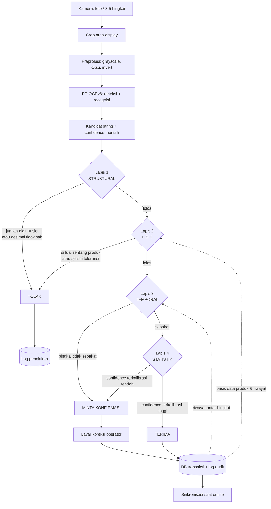

# Draft Laporan 01 — Kerangka Proposal

> Status: DRAF untuk dilaporkan ke pembimbing.
> Basis keputusan: kandidat **K1**, bentuk TA **sistem (Varian B)**.
> Kebijakan data: latih sintetis, uji memuat foto nyata.
> Enam bagian sesuai tugas: judul, ringkasan, state of the art, tema utama, referensi, arsitektur.

---

## 1. Judul

**Rekomendasi utama:**

> **Verifikasi Kontekstual Hasil Pembacaan Display Tujuh Segmen untuk Sistem Pencatatan Timbangan Digital**

Nama model (PP-OCRv6) sengaja tidak dimasukkan. Alasannya: model jenis ini berganti generasi dalam hitungan bulan, sedangkan judul harus bertahan sampai sidang dan sesudahnya. Nama model tetap muncul di Bab I dan Bab III, bukan di judul.

**Opsi alternatif:**

| # | Judul | Catatan |
|---|---|---|
| A | Sistem Pencatatan Timbangan dengan Verifikasi Berlapis Pembacaan Display Tujuh Segmen | Menonjolkan kata "sistem", cocok untuk Varian B |
| B | Verifikasi Berlapis untuk Menekan Kesalahan Senyap pada Pembacaan Display Tujuh Segmen | Paling menonjolkan kontribusi, tapi istilah "kesalahan senyap" perlu didefinisikan lebih awal |

---

## 2. Ringkasan / Gambaran Umum

Pencatatan berat barang di gudang dan pabrik masih banyak dilakukan manual: operator membaca angka pada display timbangan digital lalu menuliskannya. Cara ini tidak memiliki pembanding otomatis dan tidak meninggalkan jejak audit, sehingga kesalahan catat tidak terdeteksi dan sengketa jumlah barang sulit ditelusuri. Kebutuhan akan perekaman otomatis sudah mulai dijawab di literatur, antara lain oleh sistem *data logger* berbasis CRNN-CTC untuk display tujuh segmen [S01].

Penelitian ini tidak mengulang persoalan pembacaan, melainkan mengambil titik yang belum dijawab. S01 melaporkan akurasi pengenalan, tetapi tidak melaporkan bagaimana sistem bersikap ketika bacaannya salah [S01]. Pada 24 sumber yang ditelusuri (S01–S24), tidak ditemukan pelaporan *silent error rate*, kurva risk–coverage, maupun *selective accuracy* untuk display tujuh segmen. Padahal dalam pencatatan timbangan, satu bacaan salah lebih mahal daripada sepuluh bacaan yang ditolak, karena bacaan salah masuk ke catatan dan baru diketahui setelah transaksi selesai.

Pendekatan yang diusulkan: menambahkan empat lapis verifikasi kontekstual di atas keluaran model OCR. Lapis pertama **struktural** — jumlah digit terhadap jumlah slot dan posisi desimal yang sah. Lapis kedua **fisik** — rentang berat produk, toleransi, dan selisih terhadap riwayat. Lapis ketiga **temporal** — kesepakatan antar bingkai pada pembacaan yang sama. Lapis keempat **statistik** — keyakinan model yang sudah dikalibrasi. Keluaran sistem bukan sekadar teks angka, melainkan keputusan **terima, tolak, atau minta konfirmasi**, beserta alasannya.

Model dasar yang dipakai adalah PP-OCRv6, keluarga model OCR ringan berukuran 1,5 hingga 34,5 juta parameter yang dirilis Juni 2026 [S14]. Model ini dipilih karena tiga hal: ukurannya memungkinkan berjalan offline pada perangkat terbatas, arsitekturnya dirancang khusus untuk OCR dan mengklaim mengungguli model bahasa-visi berukuran miliaran parameter pada tugas serupa [S14], dan secara eksplisit menyebut display digital sebagai sasaran khusus [S14]. Yang belum terjawab: model ini belum pernah diuji pada display tujuh segmen.

Data latih dihasilkan secara sintetis dengan kondisi terkontrol; data uji memuat citra timbangan nyata yang dikunci. Keberhasilan diukur dengan *silent error rate*, *coverage*, *selective accuracy*, dan luas daerah di bawah kurva risk–coverage, bukan dengan akurasi semata.

---

## 3. State of the Art

### 3.1 Peta pendekatan

Literatur pembacaan display tujuh segmen dapat dipetakan menjadi lima kelompok.

| # | Kelompok | Sumber | Hasil yang dilaporkan | Keterbatasan untuk penelitian ini |
|---|---|---|---|---|
| 1 | Klasik non-pembelajaran mesin | [S18] ssocr; [S09] binarisasi adaptif + proyeksi + Hamming | 99,7% pada 1.146 karakter, 20 ms, diuji pada timbangan elektronik [S09] | Bergantung pada kondisi citra; tidak melaporkan perilaku saat gagal |
| 2 | Deep learning khusus tujuh segmen | [S01] CRNN-CTC; [S07] generator sintetis + model desimal terpisah; [S08] kepala inferensi digit; [S16] YOLO angka riil; [S17] YOLOv8 + CRNN; [S04] DBNet + PARSeq; [S11] model short-memory; [S06] semi-supervised; [S10] koreksi iluminasi | 90,37% exact match, CER 3,6% [S01]; 96,8% [S07]; 97,8% per bingkai, 30 fps [S08]; 98% [S17] | Semua berhenti pada akurasi dataset sendiri; tidak ada pelaporan keandalan |
| 3 | Dataset dan tolok ukur | [S03] UFPR-AMR; [S12] citra mentah meter energi | 2.000 citra, 10.000 anotasi digit [S03] | Mayoritas meter energi listrik, bukan timbangan |
| 4 | OCR umum generasi baru | [S14] PP-OCRv6; [S22] PP-OCRv5 | 83,2% akurasi pengenalan rata-rata 15 kategori, 34,5 juta parameter [S14]; PP-OCRv5 5 juta parameter menyaingi model bahasa-visi miliaran parameter [S22] | Mengklaim menangani digital display [S14], belum diuji pada tujuh segmen |
| 5 | Model bahasa-visi | [S02] Gemini dan lima mesin OCR; [S13] MeasureBench | FSR 93,85%, akurasi per digit 98,10% [S02]; terbaik hanya 30,2% pada data nyata [S13] | Akurat pada transkripsi, lemah pada inferensi skala [S13]; biaya dan kebutuhan jaringan |

Dasar metode yang dipakai kelompok 2 dan 4: CRNN [S19], CTC [S20], NRTR [S21], PARSeq [S24]. Konteks penerapan bergerak: dari meter energi [S03, S12] ke kamera ponsel untuk LCD medis [S05] dan pembacaan layar digital dengan *one-shot learning* [S23].

### 3.2 Dua angka yang tampak bertentangan

S02 melaporkan FSR 93,85% untuk Gemini pada perangkat ukur digital [S02], sementara S13 melaporkan model bahasa-visi terbaik hanya 30,2% pada data nyata [S13]. Keduanya tidak bertentangan: S13 menguji pembacaan nilai yang menuntut penalaran spasial dan inferensi skala, sedangkan S02 menguji transkripsi digit yang sudah tertulis.

Implikasi penulisan: jangan menulis "model bahasa-visi belum mampu membaca alat ukur". Yang benar: model bahasa-visi lemah pada inferensi skala tetapi kuat pada transkripsi digit; karena itu pada domain ini ia bukan pesaing akurasi, melainkan pesaing biaya.

### 3.3 Celah yang tersisa

| Celah | Isi | Status |
|---|---|---|
| G1 | Keandalan tidak pernah dilaporkan: tidak ada *silent error rate*, kurva risk–coverage, kalibrasi keyakinan, maupun *selective accuracy* untuk tujuh segmen | Terbuka |
| G3 | Verifikasi kontekstual tidak ada: tidak ada yang memakai konteks luar gambar untuk memutuskan kelayakan bacaan | Terbuka |
| G6 | PP-OCRv6 belum diuji pada tujuh segmen [S14] | Terbuka |
| G2 | Tidak ada tolok ukur lintas dataset | Terbuka |
| G4 | Error digit berulang dan titik desimal hanya catatan anekdotal [S17, S07] | Terbuka sebagian |

### 3.4 Angka yang beredar tidak dapat dibandingkan

90,37% [S01], 96,8% [S07], 97,8% [S08], 99,7% [S09], 98% [S17], dan 93,85% [S02] dihasilkan dari data, pembagian latih-uji, dan definisi "benar" yang berbeda-beda. Tidak ditemukan studi yang melatih pada satu dataset lalu mengujinya pada dataset lain.

---

## 4. Tema Utama

### 4.1 Tema

> **Keandalan, bukan akurasi: membuat sistem pembacaan timbangan tahu kapan dirinya tidak layak dipercaya.**

### 4.2 Tiga sub-tema

**Sub-tema 1 — Kesalahan senyap sebagai persoalan utama.**
Metrik yang lazim dipakai di literatur adalah CER dan *exact match* [S01, S07, S08]. Keduanya mengukur seberapa sering model benar, bukan apakah sistem memberi tahu ketika salah. Pada domain penimbangan, bacaan salah yang diterima tanpa peringatan adalah kegagalan yang paling mahal, karena ia masuk ke catatan dan baru terdeteksi setelah transaksi selesai. Karena itu metrik utama penelitian ini adalah *silent error rate*, bukan akurasi.

**Sub-tema 2 — Konteks di luar gambar sebagai sumber informasi baru.**
Seluruh pendekatan pada kelompok 1 dan 2 mengambil keputusan dari citra saja. Penelitian ini menambahkan informasi yang tidak ada di dalam citra: jumlah slot digit pada display, rentang berat sah untuk suatu produk, toleransi penimbangan, kesepakatan antar bingkai, dan keyakinan yang sudah dikalibrasi. Konsekuensinya, kontribusi tidak dapat direduksi menjadi "model yang lebih baik": bila model dasarnya diganti, lapisan verifikasi tetap berlaku.

**Sub-tema 3 — Selective prediction sebagai kerangka evaluasi.**
Keputusan menerima atau menolak bacaan adalah persoalan *selective prediction*: sistem boleh menolak memprediksi. Kerangka ini sudah mapan di bidang lain, tetapi belum dipakai pada domain display tujuh segmen. Yang diukur bukan satu angka akurasi, melainkan hubungan antara *coverage* (berapa persen bacaan diterima otomatis) dan akurasi pada bacaan yang diterima, yang dinyatakan sebagai kurva risk–coverage dan diringkas sebagai AURC.

### 4.3 Posisi terhadap penelitian terdekat

| Dimensi | S01 [S01] | Penelitian ini |
|---|---|---|
| Pertanyaan | Bisakah display tujuh segmen dibaca dan dicatat otomatis? | Kapan bacaan tidak layak dipercaya, dan bagaimana sistem tahu? |
| Masukan | Citra | Citra + konteks luar gambar |
| Keluaran | String angka | String + terima/tolak/konfirmasi + alasan |
| Metrik utama | CER, exact match | Silent error, coverage, selective accuracy, AURC |

---

## 5. Referensi

Daftar lengkap tersimpan di `references/references.bib`. Ringkasan 24 sumber:

| ID | Sitasi | Tahun | Venue |
|---|---|---|---|
| S01 | Effendi, B. P. G.; Adiperdana, B.; Faizal, F. | 2025 | Jurnal Ilmu dan Inovasi Fisika 9(2) 107–115 |
| S02 | Ega, A. V.; Gunawan, D.; Halim, A.; Samodro, R. A. | 2026 | Bulletin of Electrical Engineering and Informatics 15(5) 4239–4252 |
| S03 | Laroca, R.; Barroso, V.; Diniz, M. A.; Gonçalves, G. R.; Schwartz, W. R.; Menotti, D. | 2019 | Journal of Electronic Imaging 28(1) 013023 |
| S04 | Low, L. M.; Mohd Salleh, F. H.; Law, Y. F.; Zakaria, N. Z. | 2024 | ITM Web of Conferences 63 01007 |
| S05 | Kulkarni, S. S.; Katebi, N. dkk. | 2021 | Frontiers in Artificial Intelligence 4 543176 |
| S06 | Xiang, X.; Zhu, C.; Ou, Z. dkk. | 2026 | Sensors 26(1) 265 |
| S07 | Gushima, K.; Kashima, T. | 2023 | PHM Society Asia-Pacific Conference |
| S08 | Yenneti, S.; Chiou, Y.-M.; Price, B. | 2023 | Electronic Imaging 35(7) 282 |
| S09 | Jiang, H.; Li, X. | 2026 | Proc. SPIE |
| S10 | Fu, H.; Xie, Z.; Jiang, W.; Ma, X. | 2026 | Journal of Imaging 12(4) 146 |
| S11 | Wei, S.; Li, X.; Yao, Y.; Yang, S. | 2023 | Algorithms 16(4) 192 |
| S12 | Kanagarathinam, K.; Sekar, K. | 2019 | Energy Reports 5 842–852 |
| S13 | Lin, F. dkk. | 2026 | CVPR 2026 (arXiv:2510.26865) |
| S14 | Zhang, Y. dkk. | 2026 | arXiv:2606.13108 |
| S15 | Valente, J.; Dehban, A.; Ventura, R. | 2025 | arXiv:2508.21732 |
| S16 | Bonilla-Rivas, F.; Cárdenas-Angelat, C.; Garrido-Díaz, A.; Aguayo-Torres, M. C. | 2023 | ICCNS, 19–25 |
| S17 | OICWS | 2026 | GitHub: lcd-digit-recognition |
| S18 | Auerswal, O. | — | ssocr (perangkat lunak) |
| S19 | Shi, B.; Bai, X.; Yao, C. | 2017 | IEEE TPAMI 39(11) |
| S20 | Graves, A.; Fernández, S.; Gomez, F.; Schmidhuber, J. | 2006 | ICML |
| S21 | Sheng, F.; Chen, Z.; Xu, B. | 2019 | ICDAR |
| S22 | Zhang, Y. dkk. | 2026 | arXiv:2603.24373 |
| S23 | Charles, J. dkk. | 2021 | WACV |
| S24 | Bautista, D.; Atienza, R. | 2022 | ECCV (arXiv:2207.06966) |

DOI dan URL lengkap ada di `docs/research/source-ledger.md`.

---

## 6. Arsitektur (Bagan Alur)

### 6.1 Bagan alur utama



### 6.2 Bagan alur alternatif (teks, bila pratinjau bagan tidak tersedia)

```
foto / video pendek
        |
        v
  [crop area display] -> [praproses: grayscale, Otsu, invert]
        |
        v
  PP-OCRv6 (deteksi + recognisi)  -->  kandidat "48.65", conf 0.91
        |
        +--> LAPIS 1 STRUKTURAL : jumlah digit vs slot, posisi desimal sah
        |            gagal -> TOLAK
        +--> LAPIS 2 FISIK      : rentang produk, toleransi, delta riwayat
        |            gagal -> TOLAK
        +--> LAPIS 3 TEMPORAL   : agreement antar bingkai
        |            gagal -> MINTA KONFIRMASI
        +--> LAPIS 4 STATISTIK  : confidence terkalibrasi
        |            rendah -> MINTA KONFIRMASI
        v
   TERIMA -> DB transaksi + log audit -> sinkronisasi
```

### 6.3 Penjelasan setiap blok

| Blok | Masukan | Keluaran | Alasan keberadaannya |
|---|---|---|---|
| Akuisisi | Foto atau 3–5 bingkai video | Citra + metadata waktu | Lapis 3 membutuhkan beberapa bingkai dari pembacaan yang sama |
| Crop | Citra penuh | Area display | Mengurangi gangguan latar |
| Praproses | Area display | Citra siap model | Menyamakan kontras LED dan LCD pasif |
| PP-OCRv6 | Citra | String + confidence mentah | Model dasar [S14]; confidence mentah belum berarti apa pun tanpa kalibrasi |
| Lapis 1 struktural | String + geometri slot | Lolos / tolak | Menangkap pola kegagalan CTC pada digit berulang dan titik desimal [S17, S20] |
| Lapis 2 fisik | Angka + konfigurasi produk | Lolos / tolak | Menangkap bacaan yang mustahil secara domain |
| Lapis 3 temporal | Beberapa bingkai | Lolos / konfirmasi | Bacaan benar stabil, kesalahan berubah-ubah; gagasan penyaringan antar bingkai sudah dipakai [S08] tetapi belum untuk keputusan terima/tolak |
| Lapis 4 statistik | Confidence + split kalibrasi | Lolos / konfirmasi | Mengubah skor model menjadi perkiraan peluang benar |
| Keputusan | Hasil keempat lapis | Terima / tolak / konfirmasi | Inti kontribusi: sistem berhenti menjadi pembaca dan menjadi penjaga gerbang |
| Penyimpanan | Keputusan + alasan | Baris DB + log audit | Menjadi bahan perhitungan silent error dan tingkat koreksi operator |

### 6.4 Di mana setiap metrik dihitung

| Metrik | Dihitung di | Butuh apa |
|---|---|---|
| FSR, CER | Keluaran PP-OCRv6, sebelum verifikasi | Label ground truth |
| Akurasi posisi desimal | Keluaran PP-OCRv6 | Label posisi desimal |
| Silent error rate | Setelah keputusan | Label + status keputusan |
| Coverage | Setelah keputusan | Status keputusan |
| Selective accuracy | Pada bacaan yang diterima | Label + status keputusan |
| AURC | Kurva risk–coverage | Confidence terkalibrasi + status keputusan |
| Tingkat koreksi operator | Layar koreksi | Log koreksi |
| Latensi p50/p95 | Seluruh alur | Stempel waktu per tahap |

### 6.5 Urutan pembangunan yang disarankan

1. Akuisisi + praproses + PP-OCRv6 (W3) — tanpa ini tidak ada yang bisa diukur.
2. Lapis 1 struktural (W5) — paling murah, paling cepat memberi sinyal.
3. Lapis 2 fisik (W6) — butuh keputusan domain lebih dulu.
4. Lapis 3 temporal + Lapis 4 kalibrasi (W7) — paling banyak bergantung pada data.
5. Keputusan, penyimpanan, antarmuka (W8).

Alasan urutan ini: setiap lapis harus dapat diukur dampaknya secara terpisah. Menggabungkan beberapa lapis sekaligus membuat penyebab perubahan *silent error* tidak dapat dipisahkan.

---

## 7. Butir yang masih perlu diverifikasi

| Hal | Status | Tindakan |
|---|---|---|
| `exact match 90,37%` dan `197/218` pada S01 | `[PERLU CEK]` | Unduh PDF lewat akun kampus, periksa bagian hasil |
| Ukuran input `200×100` pada S01 | `[PERLU CEK]` | Periksa bagian metode |
| Pemakaian YOLOv8 oleh S01 | `[PERLU CEK]` | Periksa bagian metode |
| Ada tidaknya gerbang keyakinan pada sistem S01 | `[PERLU CEK]` | Periksa bagian metode dan pembahasan |
| Ukuran dataset latih S01 | `[PERLU CEK]` | Menentukan kewajaran perbandingan angka |
